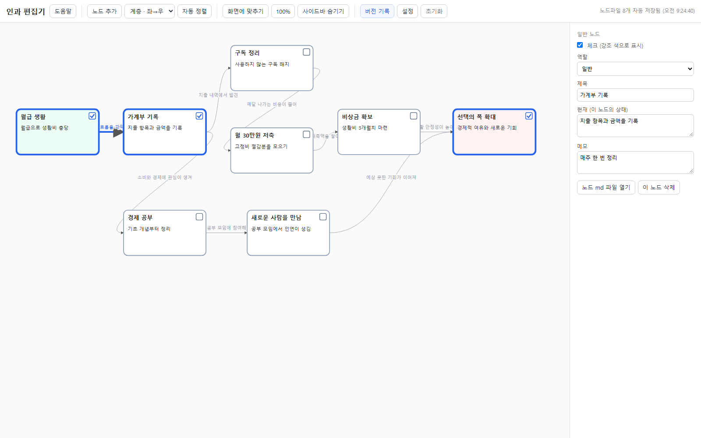
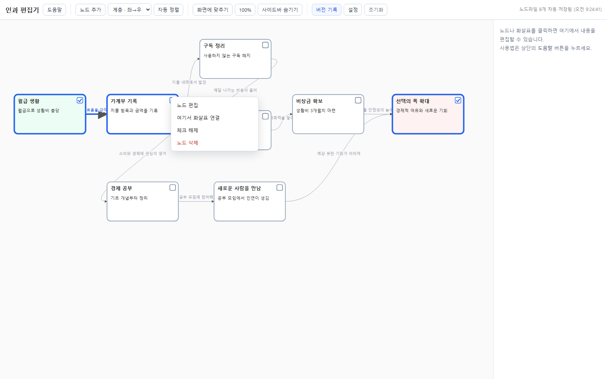
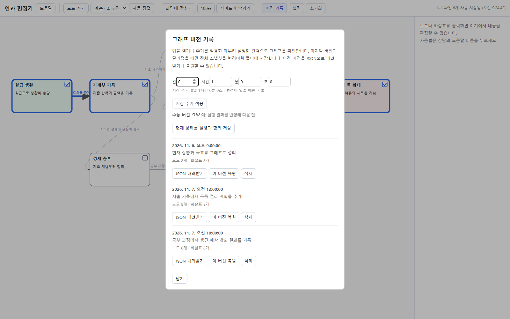

# 리얼리티 코딩 + 인과 편집기

처음 보는 분을 위해 한 문장으로 설명하면, **사람과 AI가 대화로 세운 계획, 실제로 한 행동, 그 뒤에 일어난 결과를 인과 그래프로 기록하는 개인용 도구**입니다.

> “인과 편집기는 엔진이고, 리얼리티 코딩은 방법론이다. 이 도구는 내가 직접 써도 되지만, AI와 대화하면서 계획과 결과를 기록·수정·보관하게 하려고 만들었다.”
>
> — 제작자의 설명을 바탕으로 정리

**인과 편집기**는 기록을 만들고 고치는 프로그램(엔진)입니다. **리얼리티 코딩**은 AI가 다음 행동을 제안하고, 사람이 현실에서 실행한 뒤 결과를 다시 대화에 가져와 계획을 갱신하는 방법(방법론)입니다. AI가 앱을 대신 조작해야만 쓸 수 있는 것은 아닙니다. 직접 그래프를 편집해도 되고, AI와 함께 기록을 관리해도 됩니다.

### AI와 함께 문서를 관리하는 방법

이 폴더를 **GPT Codex** 또는 **Claude Code**에서 프로젝트(작업 폴더)로 열고 대화하면, AI는 대화만으로 답하는 데 그치지 않고 프로젝트 폴더의 파일을 직접 다룰 수 있습니다. 요청에 따라 문서를 **새로 만들고, 내용을 편집하고, 불필요한 문서를 삭제**하며, 인과 편집기의 그래프와 노드별 Markdown 기록을 함께 갱신할 수 있습니다. 예를 들어 “이번 대화에서 정한 실행 계획을 문서로 정리해 그래프에도 반영해 줘”라고 요청할 수 있습니다.

AI가 파일을 읽거나 수정할 수 있는 범위는 Codex나 Claude Code에 이 폴더를 열어 준 설정과 권한에 따릅니다. 중요한 변경은 대화에서 확인하고, 인과 편집기의 **버전 기록**으로 그래프 스냅샷을 보관할 수 있습니다. 버전 기록은 그래프의 노드·화살표·설정을 저장하는 기능이며, 폴더 안의 모든 문서를 자동으로 버전 관리하는 기능은 아닙니다. 일반 문서의 변경 이력은 Git 등 파일 버전 관리 기능을 함께 사용해 보관할 수 있습니다.

예를 들어 “지출을 파악하고 저축을 늘리고 싶다”고 대화하면, 현재 상태와 행동을 노드로 적고 “가계부 기록 → 구독 정리 → 저축”처럼 원인과 결과를 화살표로 잇습니다. 실제로 해 본 뒤 달라진 점이나 예상하지 못했던 결과를 추가합니다. 계획이 바뀌어도 이전 버전은 기록으로 남습니다.

### 실행 화면 예시

아래 화면은 기능을 설명하기 위해 만든 **가상의 예시 데이터**입니다. 실제 사용자의 기록은 포함하지 않습니다.

| 인과 그래프 | 오른쪽 클릭 메뉴 | 버전 기록 |
|---|---|---|
|  |  |  |

인과 그래프는 현재 상태와 여러 갈래의 행동·결과를 한눈에 보여 줍니다. 노드와 화살표를 편집하고, 그래프가 달라졌을 때 버전 기록을 남길 수 있습니다.

사용자는 목적과 상황을 이야기하고, 인공지능은 대화에서 확인한 내용을 인과 편집기의 그래프에 반영합니다. 사용자가 실제로 행동한 뒤 결과를 알려 주면, 인공지능은 그 결과를 기록하고 다음 계획을 함께 고칩니다. 그래프와 노드별 Markdown 파일은 이 대화가 쌓아 온 맥락을 구조적으로 보존하는 기록입니다.

삶을 하나의 인과 그물망으로 표현합니다. 노드는 상태, 화살표는 인과(원인 → 결과)입니다. 계획대로 된 결과뿐 아니라 의외의 결과도 같은 캔버스에 나란히 쌓습니다.

## 배경: 리얼리티 코딩과 인과 편집기

**리얼리티 코딩**은 인공지능이 제안한 단계를 사람이 현실에서 실행하고, 그 결과를 다시 인공지능과 나누며 계획을 갱신하는 방법론입니다. 바이브 코딩에서는 사람이 말하면 인공지능이 코딩하지만, 리얼리티 코딩에서는 인공지능이 다음 행동을 제안하고 사람이 실행합니다. 인과 편집기는 이 방법론 자체가 아니라, 대화에서 나온 계획과 결과를 함께 기록하고 보관하는 엔진입니다.

1. 사람이 목적을 정하고 인공지능에게 필요한 것을 묻습니다.
2. 인공지능은 목적을 위해 필요한 단계를 제안합니다.
3. 사람이 실행하고, 결과를 성공, 부분 성공, 실패 등으로 알려 줍니다.
4. 인공지능은 그 결과를 반영해 전체 계획을 고칩니다.

이 사이클이 한 번 돌 때마다 계획이 한 버전씩 올라갑니다. 바이브 코딩에서 프로그램이 버전업 되듯이, 삶의 계획도 버전업 됩니다.

**인과 편집기**는 대화로 다듬어 가는 계획과 실제 삶의 변화를 기록하는 엔진입니다. 사람의 삶은 트리가 아니라 인과 사슬이 겹쳐 있는 구조입니다. 하나의 상태가 여러 과거의 결과일 수 있고, 여러 미래의 원인이 될 수도 있습니다. 그래서 마인드맵처럼 하위 노드가 하나의 상위 노드만 가지는 구조로는 담을 수 없습니다.

**삶은 나뉘지 않습니다.** 프로젝트별로 파일을 나누지 않고, 하나의 캔버스에 삶 전체를 둡니다. 언제 어떤 일이 생길지 모르므로 분류도 하지 않습니다.

**의외성을 담습니다.** 경제 공부를 하다가 사람을 만날 수도 있습니다. 목적과 무관한 결과도 지우지 않고 같은 그래프에 남깁니다. 그 의외의 가지가 나중에 다른 원인이 되기도 합니다.

## 개념

| 개념 | 구현 |
|---|---|
| 노드 = 하나의 상태 | 제목, 현재 상태, 메모, 위치, 체크 |
| 원인과 결과는 화살표로 표현 | 화살표가 원인 노드 → 결과 노드를 잇고, 설명과 메모를 가짐 |
| 한 상태가 여러 원인·결과를 가짐 | 화살표는 자유롭게 연결되는 그물망. 트리 구조가 아님 |
| 시작과 종료 | 사용자가 노드 편집 칸의 '역할'에서 정함. 시작과 종료는 각각 하나만 지정 가능 |
| 목적과 무관한 결과 | 종료에 닿지 않는 가지도 지우지 않고 그대로 둠 |
| 하나의 캔버스 | 프로젝트 구분 없이 삶 전체를 한 파일, 한 캔버스에 둠 |

결과가 성공인지 실패인지는 화살표에 따로 분류하지 않습니다. 설명이나 메모에 자유롭게 적습니다.

## 실행 방법

1. `실행.bat`을 더블클릭합니다. 도우미 서버가 켜지고 브라우저에서 편집기가 열립니다.
2. 편집기를 쓰는 동안에는 실행 창을 닫지 마세요. 닫으면 편집기가 꺼지고 노드 파일 자동 저장도 멈춥니다.

편집기 화면은 `프로그램/index.html`에 있습니다. 노드 파일 저장과 md 열기는 `프로그램/server.js`가 맡으므로, HTML을 직접 더블클릭하면 저장되지 않습니다. 실행에는 Node.js가 필요합니다.

## 조작법

- **빈 곳 더블클릭**: 노드 추가
- **캔버스에서 오른쪽 클릭**: 빈 곳·노드·화살표에 맞는 편집기 메뉴 열기
- **빈 캔버스를 누른 채 드래그**: 화면 이동
- **노드 드래그**: 위치 이동
- **노드 선택 → Shift+클릭 다른 노드**: 화살표 연결 (선택한 노드가 원인, 클릭한 노드가 결과)
- **화살표 클릭**: 인과 설명과 메모 입력
- **노드 또는 화살표 선택 → Delete**: 삭제
- **노드 오른쪽 위 체크박스**: 체크하면 기본 파란색 테두리로 표시됩니다. 노드 편집 칸에서도 체크할 수 있습니다.
- **노드 편집 칸의 '역할'**: 일반, 시작, 종료 중 하나를 고릅니다.
- **노드 md 파일 열기**: 선택한 노드의 `.md` 파일을 PC 기본 프로그램(메모장 등)으로 엽니다.
- **정렬 방식 선택**: 계층(좌→우), 피라미드(인과 단계별 위→아래), 다이아몬드(시작은 위·종료는 아래, 중간은 좌우로 펼침), 원형, 격자 중 하나를 고르면 즉시 배치하고 화면에 맞춥니다.
- **전체 그래프 보기**: 전체 그래프가 한 화면에 보이도록 크기를 조정합니다. **실제 크기**는 확대율을 원래 크기로 되돌립니다. 확대 비율은 저장되지 않습니다.
- **사이드바 숨기기 / 보이기**: 오른쪽 편집 패널을 접거나 다시 엽니다. 표시 상태는 브라우저에 기억됩니다.
- **그래프 목록**: 오른쪽 사이드바에는 `노드파일` 안에 그래프 JSON이 실제로 저장된 폴더만 표시합니다. 폴더를 선택해 그래프를 전환하며, 버전 스냅샷은 목록에 중복 표시하지 않습니다.
- **초기화**: 현재 그래프를 변경 이력에 보관하고 새 빈 그래프를 만듭니다. 기존 그래프 폴더는 그대로 남아 목록에서 다시 열 수 있습니다.
- **포커스 모드**: 노드를 선택한 뒤 켜면 그 노드와 화살표 하나로 바로 연결된 원인·결과 노드만 표시합니다. 포커스 중 다른 노드를 선택하면 그 노드를 중심으로 표시가 바뀝니다. 체크 여부나 강조 색은 바뀌지 않으며, **포커스 종료**를 누르면 전체 그래프가 다시 나타납니다.
- **도움말**: 상단 버튼으로 조작법을 봅니다.
- **버전 기록**: 저장 주기를 설정하고 변경된 그래프만 자동 기록합니다. 수동 요약을 붙이거나 이전 버전을 JSON으로 내려받고 복원할 수도 있습니다.

## 강조 규칙

- 체크된 노드는 기본 파란색 테두리로 표시됩니다.
- 선택된 노드는 기본 주황색 테두리로 표시됩니다. 두 강조 색은 설정에서 각각 바꿀 수 있습니다.
- **양 끝 노드가 모두 체크된 화살표만** 굵고 체크 강조 색으로 보입니다. 나머지 화살표는 가는 선에 설정의 연결선 색을 씁니다.
- 선택된 화살표는 조금 더 굵어집니다.

## 설정

상단 **설정** 버튼에서 바꿉니다. 설정은 그래프와 함께 저장됩니다.

| 항목 | 내용 |
|---|---|
| 노드 모양 | 사각형 또는 원형 |
| 노드 색 | 노드 안쪽 채우기 색 |
| 배경 색 | 캔버스 배경 색 |
| 연결선 모양 | 곡선 또는 직선 |
| 연결선 색 | 일반 화살표의 색 |
| 체크 강조 색 | 체크된 노드 테두리와, 양 끝이 모두 체크된 화살표의 색. 기본 파란색 |
| 선택 강조 색 | 현재 선택한 노드 테두리의 색. 기본 주황색 |
| 캔버스 바깥 여백 | 그래프 주위에 추가할 작업 공간. 0~1000px로 조절하며 전체 그래프 보기에 포함 |

색은 입력칸에 `#rrggbb` 형식으로 적거나, 미리 정한 색 버튼으로 고릅니다. '기본값으로' 버튼으로 처음 상태로 되돌릴 수 있습니다.

설정 창 안에 **JSON 저장**, **JSON 불러오기**, **예시 가져오기**가 있습니다.
- JSON 저장: 그래프 전체(설정 포함)를 파일 하나로 내려받습니다. 백업이나 다른 PC로 옮길 때 씁니다.
- JSON 불러오기: 파일의 내용으로 현재 화면을 통째로 바꾸고, 파일 이름에 맞는 그래프 폴더를 만듭니다. 현재 그래프는 변경 이력에 먼저 백업됩니다.
- 예시 가져오기: `샘플_부자되기.json`에서 예시를 다시 불러옵니다. 원본 샘플 파일은 수정하지 않습니다.

## 버전 기록

상단의 **버전 기록**에서 자동 저장 주기를 일·시간·분·초로 지정합니다. 주기가 돌아올 때마다 현재 그래프를 마지막 버전과 비교하고, 달라졌을 때만 스냅샷을 기록합니다. 바뀐 내용이 없으면 새 파일을 만들지 않습니다. 버전에는 노드, 화살표, 설정이 포함됩니다. 중요한 변경에는 요약을 붙여 수동 버전을 만들 수도 있고, 이전 버전을 JSON으로 내려받거나 복원하거나 삭제할 수 있습니다.

JSON 불러오기와 그래프 초기화는 작업 전 상태를 자동 백업합니다. 버전 파일은 프로젝트 폴더의 `변경이력` 안에 JSON으로 저장됩니다. 자동 저장 주기 설정은 현재 브라우저에 보관되고, 변경 기록은 같은 프로젝트 폴더에서 이어 볼 수 있습니다. 노드별 Markdown 파일은 항상 최신 상태를 반영하고, 이전 내용은 그래프 버전 스냅샷에 보관됩니다.

## 노드 파일 자동 저장

노드와 화살표를 바꾸면 `노드파일` 아래 현재 그래프의 폴더에 JSON과 Markdown 기록이 자동으로 저장됩니다. 그래프마다 별도 폴더를 사용해 같은 노드 번호의 파일이 서로 덮어써지지 않습니다. 사이드바 그래프 목록에는 유효한 그래프 JSON이 들어 있는 실제 폴더만 나타납니다.

- 각 그래프 폴더에는 그래프 JSON, 노드별 `.md` 파일, `_경로.md`가 있습니다. 예: `노드파일/그래프_A/그래프_A.json`, `노드파일/그래프_A/n1_상태.md`.
- 각 노드 파일에는 제목, 현재 상태, 메모, 들어오는 화살표(원인), 나가는 화살표(결과)가 적힙니다. 화살표는 다른 노드 파일로 연결되는 링크입니다.
- `_경로.md`에는 해당 그래프의 시작에서 종료까지 이어지는 경로가 정리됩니다.
- 노드를 지우면 서버가 해당 그래프 폴더에서 그 노드의 예전 파일을 정리합니다. 다른 그래프 폴더의 기록은 건드리지 않습니다.

`노드파일`과 `변경이력` 폴더에는 개인 기록이 들어가므로 저장소에 올리지 않습니다(`.gitignore`에 포함).

## 데이터 구조

```json
{
  "nextId": 14,
  "settings": {"shape": "rect", "nodeColor": "#ffffff", "bgColor": "#fafafa",
               "lineStyle": "curve", "lineColor": "#9ca3af", "highlightColor": "#2563eb",
               "selectionColor": "#ea580c", "canvasPadding": 120},
  "nodes": [
    {"id": "n1", "kind": "start", "title": "월급 생활", "now": "월급으로 생활비만 충당",
     "x": 40, "y": 80, "memo": "", "checked": false}
  ],
  "edges": [
    {"id": "e1", "from": "n1", "to": "n2", "label": "생활비 흐름을 파악하려고", "memo": ""}
  ]
}
```

- 노드 `kind`: `start`(시작) / `goal`(종료) / `normal`(일반)
- 노드 `checked`: 체크 여부. 생략하면 체크 안 됨.
- 화살표 `label`: 원인이 결과로 이어진 행동이나 상황

이전 버전에서 저장한 JSON 중 화살표에 `status` 항목이 있는 것은 그대로 불러오지만, 그 값은 더 이상 쓰지 않습니다.

## 샘플

`샘플/샘플_부자되기.json`은 노드 20개와 화살표 24개로 된 예시입니다. 설정 → **예시 가져오기**로 열어 볼 수 있습니다. 샘플의 내용은 예시일 뿐이며 실제 계획이 아닙니다.

## 파일 구성

- `실행.bat`: 서버를 켜고 브라우저로 편집기를 엽니다.
- `프로그램/server.js`: 편집기 화면 제공, 노드 Markdown 저장, 버전 JSON 저장, md 열기를 처리합니다. Node.js 기본 기능만 씁니다.
- `프로그램/index.html`: 편집기 화면 (HTML, CSS, JavaScript 한 파일)
- `샘플/샘플_부자되기.json`: 예시 데이터
- `README.md`: 프로젝트 설명과 사용 안내
- `노드파일/`: 그래프별 폴더에 그래프 JSON과 Markdown 기록을 저장합니다. 저장소에 올리지 않습니다.
- `변경이력/`: 그래프 변경 버전을 JSON으로 저장하는 폴더. 서버가 자동으로 만들며 저장소에 올리지 않습니다.

## GitHub 공개 범위

저장소에는 앱 코드, 이 README, 공개 가능한 일반 예시만 포함합니다. 실제 그래프 기록은 `노드파일/`과 `변경이력/`에, 이 도구로 만드는 개인 문서와 산출물은 `개인자료/`에 둡니다. 세 폴더는 `.gitignore`에서 제외되어 있으며 커밋이나 릴리즈에 넣지 않습니다.

## 알려진 제한

- 시작과 종료 노드는 각각 하나만 지정할 수 있습니다.
- 현재 그래프 자동 저장은 그 브라우저, 그 PC에 남습니다. 변경 이력은 프로젝트의 `변경이력` 폴더에 저장됩니다. 다른 PC로 그래프를 옮기려면 JSON 저장을 쓰세요.
- md 열기는 PC의 기본 프로그램을 씁니다. Windows, macOS, Linux에서 동작하도록 했지만, 이 프로젝트는 Windows에서만 확인했습니다.
