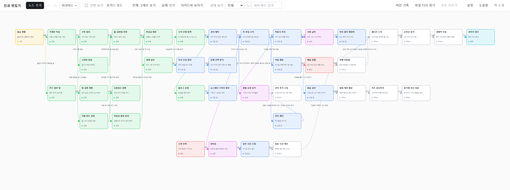
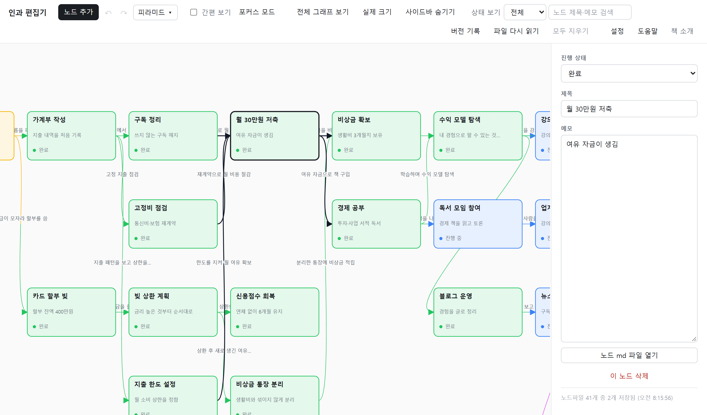
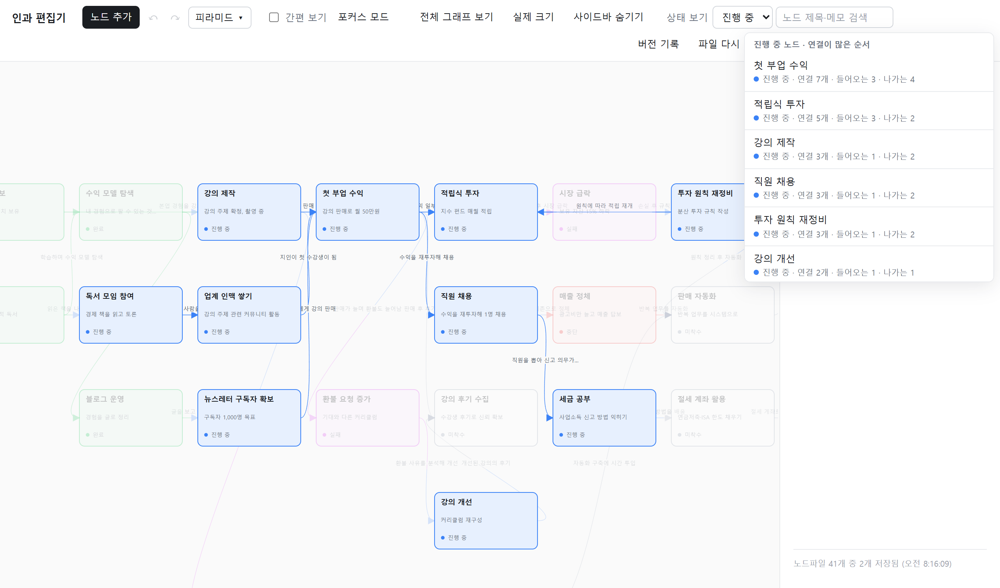
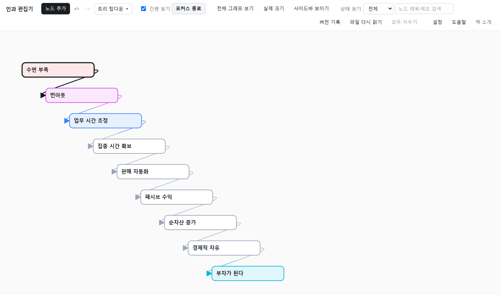
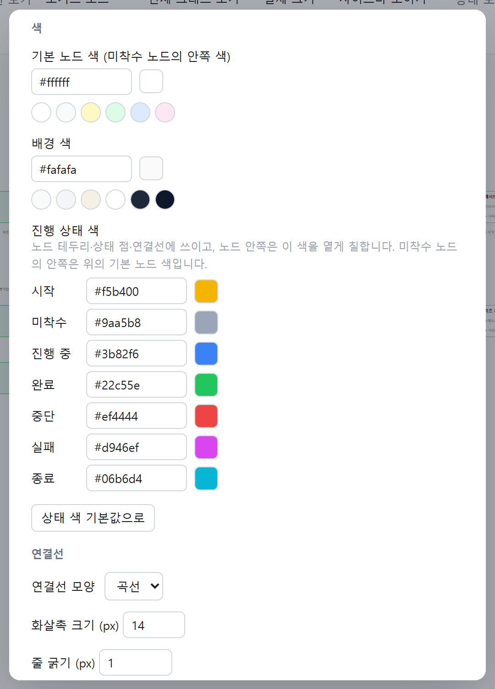

# 인과 편집기: 삶을 트리가 아니라 원인과 결과의 그래프로 그리는 무료 도구

사람의 삶은 원인과 결과로 이루어져 있습니다. 그런데 마인드맵이나 아웃라이너는 하위 항목이 상위 항목 하나만 가지는 **트리**입니다. 실제로는 하나의 상태가 여러 원인에서 나오기도 하고, 하나의 상태가 여러 결과의 원인이 되기도 합니다. 인과 편집기는 이 구조를 그대로 그리려고 만든 도구입니다.

위 그림은 가상의 예제(월급 생활에서 "부자가 된다"까지, 노드 40개와 화살표 50개)입니다. 색은 진행 상태를 뜻합니다.

## 기본 개념

- **노드**는 하나의 상태입니다. 제목, 진행 상태, 메모를 가집니다.
- **화살표**는 원인에서 결과로 이어지는 인과입니다. 화살표에도 메모를 남길 수 있습니다.
- **진행 상태**는 시작, 미착수, 진행 중, 완료, 중단, 실패, 종료의 일곱 가지이고, 상태마다 노드 색이 달라집니다. 시작과 종료는 연결로 계산하지 않고 직접 정합니다.

노드를 선택하면 그 노드에 들어오고 나가는 선이 검정으로 굵게 표시됩니다. 어디서 와서 어디로 가는지 바로 보입니다.

## 빠르게 고치기

빈 곳을 더블클릭하면 노드가 생기고, 노드를 더블클릭하면 그 자리에서 제목, 메모, 진행 상태를 바로 고칩니다. 노드를 선택한 채 다른 노드를 Shift+클릭하면 화살표가 연결됩니다.

## 노드가 많아져도 찾기 쉽게

- 상단 검색은 제목과 메모를 찾습니다. 검색창이 비어 있을 때 누르면 **연결이 많은 순서**의 목록이 나옵니다. 인과에서 중요한 노드를 찾는 데 쓰입니다.
- "상태 보기"에서 상태를 고르면 그 상태의 노드만 진하게 보이고, 검색 목록에도 그 상태만 나옵니다.

- **포커스 모드**로 한 노드에서 이어지는 경로만 따로 볼 수 있고, **트리 정렬**과 **간편 보기**를 함께 쓰면 한 줄로 이어진 흐름처럼 읽힙니다. 정렬 방식은 피라미드, 역피라미드, 다이아몬드, 원형, 격자, 트리, 연결 많은 순이 있습니다.

## 색과 모양은 설정에서

노드 모양, 배경 색, 상태별 색, 연결선 모양과 굵기를 바꿀 수 있고, 상태 색은 한 번에 기본값으로 되돌릴 수 있습니다.

## 내 데이터는 내 컴퓨터에

- 노드 하나가 **Markdown 파일 하나**로 저장됩니다. 파일에는 위치, 진행 상태, 원인과 결과 링크가 적혀 있어서 메모장으로도 읽을 수 있습니다.
- 서버는 내 컴퓨터(127.0.0.1)에서만 열리고, 편집기 탭을 닫으면 약 5초 뒤 저절로 꺼집니다. 외부 서비스로 데이터를 보내지 않습니다.
- 저장 폴더를 클라우드 동기화 폴더로 지정하면 여러 기기에서 같은 그래프를 쓸 수 있습니다.
- 파일이 곧 원본이라서, AI에게 필요한 노드 파일만 골라 읽혀 대화할 수도 있습니다.
- 버전 기록은 직접 "현재 상태 저장"을 눌렀을 때만 남습니다.

## 사용 방법

1. Node.js를 설치합니다. 별도 패키지는 필요 없습니다.
2. 저장소를 받아 `인과편집기.bat`을 실행합니다. 창 없이 서버가 켜지고 브라우저가 열립니다.
3. 예제를 보려면 설정에서 "JSON 불러오기"로 `샘플/인과편집기_예제_샘플.json`을 엽니다.

- 저장소: https://github.com/iamtalker/causal-editor

지금은 Windows 기준으로 만들고 시험했습니다. 다른 운영체제에서는 `node 프로그램/server.js`로 실행할 수 있지만 충분히 확인하지는 못했습니다.

## 책 소개

이 프로그램은 무료입니다. 제 책을 소개합니다. 도움이 되었다면 구매로 응원해 주세요.

- [부크크 서점에서 보기](https://bookk.co.kr/bookStore/6af3769e04f230844ed9303c)
